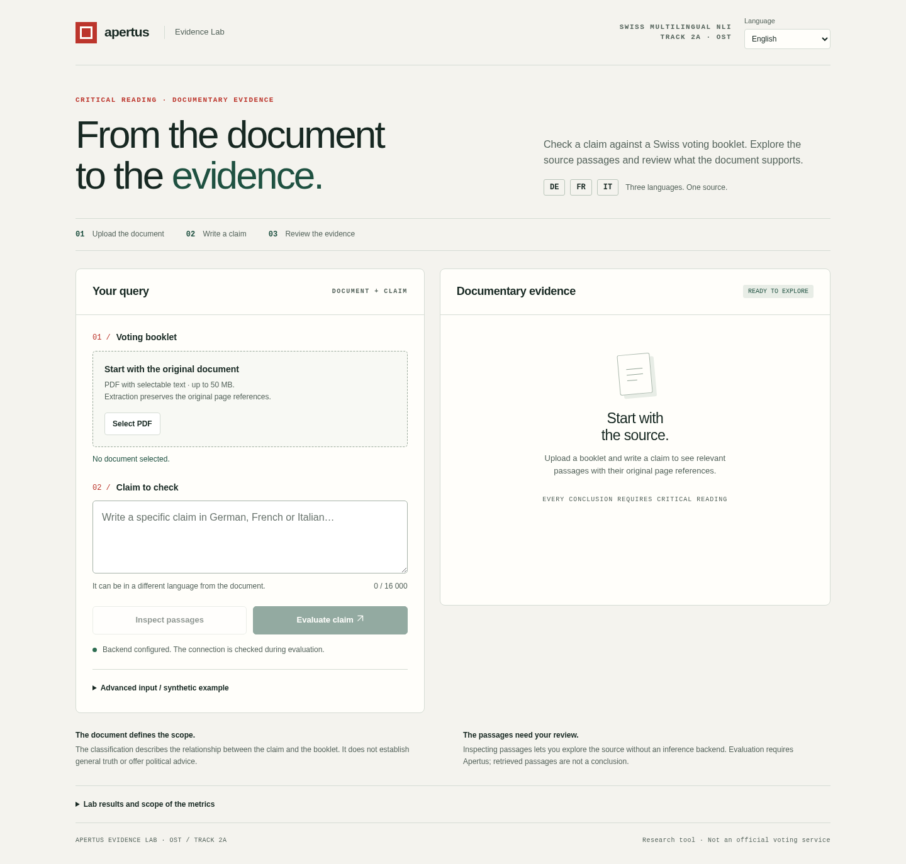
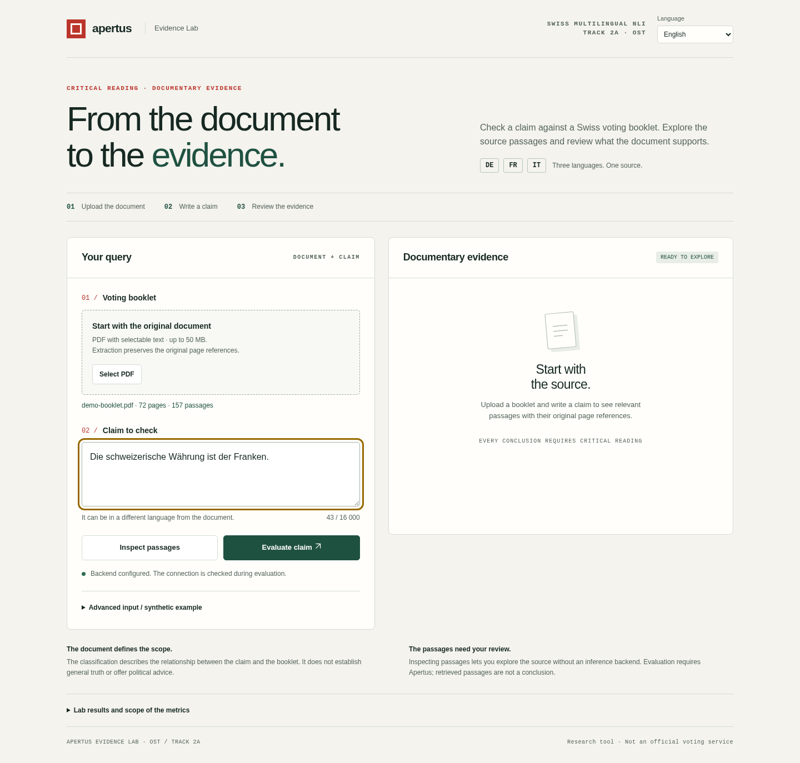
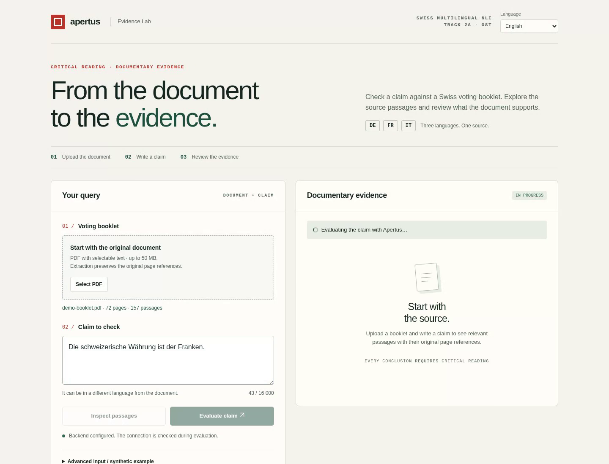
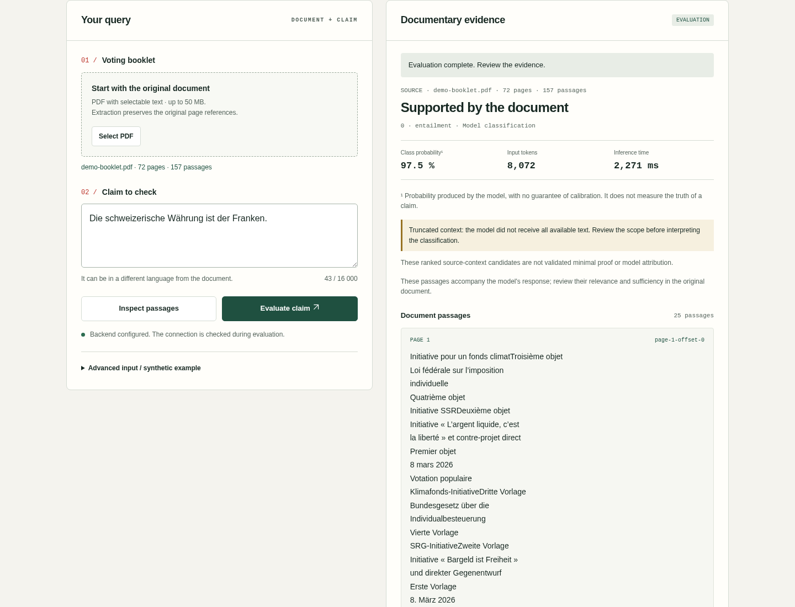
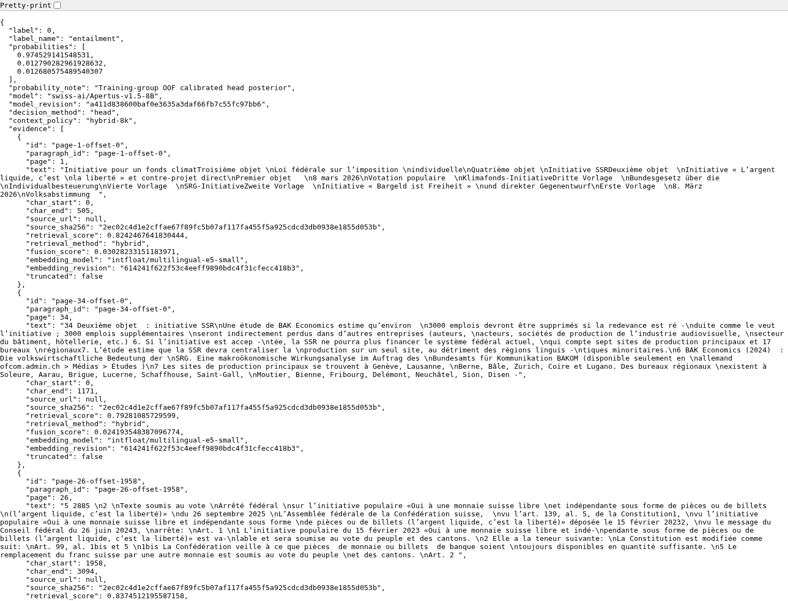
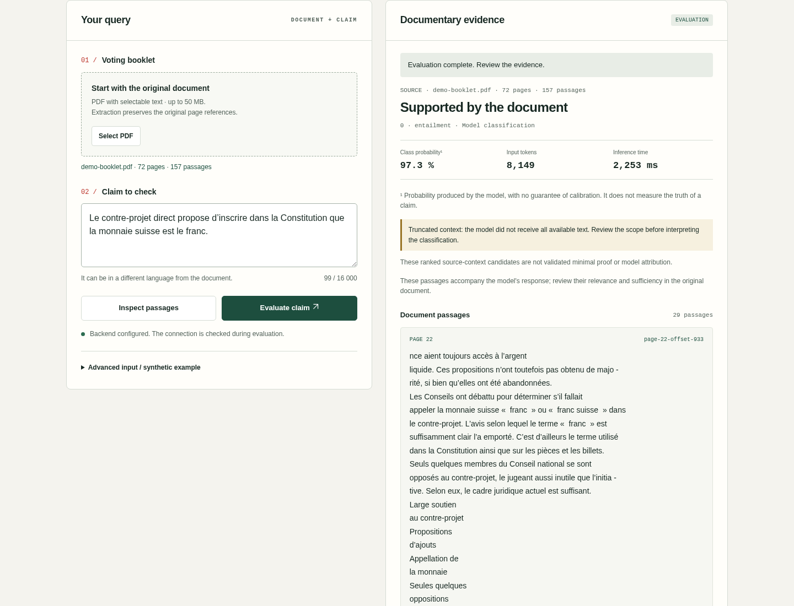
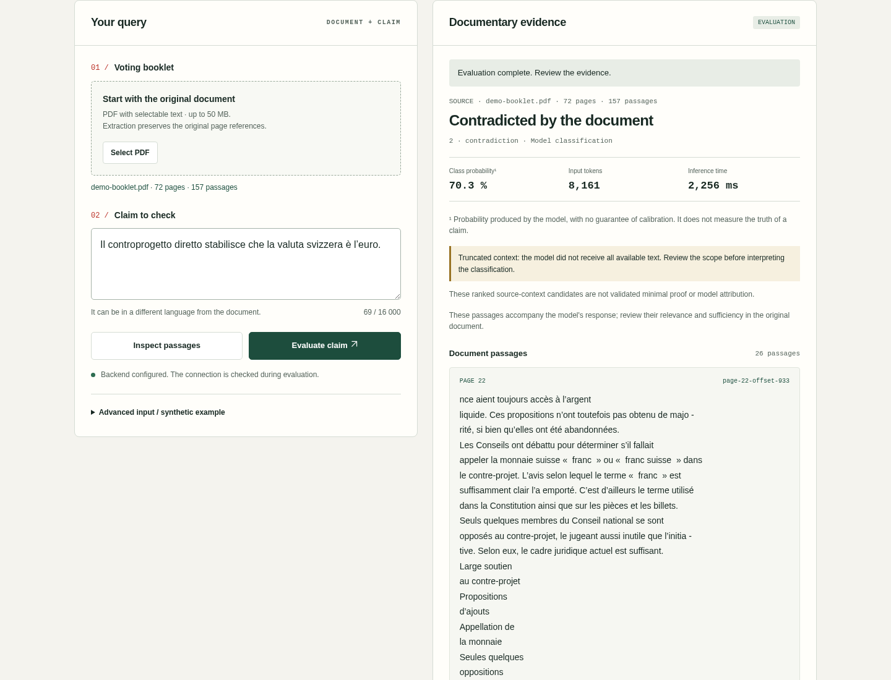

# Apertus Evidence Lab — step-by-step demo

This walkthrough uses the **English interface** and a real Apertus v1.5-8B
backend with our frozen decision head and hybrid 8k context. The screenshots
come from the recorded session; the predictions are not mocked.

[Watch the English video](apertus-demo.mp4?raw=true) · [PC setup](../TRY_ON_YOUR_PC.md)

## 1. Open the app

Start the web app with `docker compose up --build -d`. For classification,
configure the native Apertus backend as described in the PC setup guide.
Choose **English** in the language selector if your browser did not select it.
The demo backend was already configured and running.



## 2. Upload the voting booklet

Click **Select PDF** and choose the [official demo booklet](../../track_2a/data/demo/votation-2026-03-08-fr.pdf).
The app extracts **72 pages and 157 source passages**. It preserves original
page numbers; this French edition also contains German text.


## 3. Enter a claim

Type or paste this German claim:

```text
Die schweizerische Währung ist der Franken.
```

Meaning: “The Swiss currency is the franc.” The interface language does not
change the claim or the source text. DE/FR/IT claims can differ from the
booklet language.



## 4. Evaluate the claim

Click **Evaluate claim**. The app displays progress and disables inputs while
Apertus processes the request. The native backend retrieves source context,
uses the frozen Apertus representations and applies the trained decision head.



## 5. Review the decision and its source passages

The German claim returns **0 — Supported by the document**. Review the class
probability, input tokens and measured time, then read the quoted passages and
their original pages. Probability is a model output, not a guarantee of truth.
The selected context can omit parts of the full booklet; the UI reports that
scope limitation.



## 6. Download and inspect the JSON

Click **Download JSON result** below the passages. The complete result includes
the numeric label, probabilities, exact passages and pages, token usage and
inference time. You can also expand **View full response · JSON** in the app.
The demo verified that the downloaded file equals the API response.



[Open the downloaded German result](../../track_2a/experiments/apertus-live-demo-en-v1/pass-2-prediction-de.json).
The screenshot above shows the actual saved file served locally for browser inspection, not another model request.

## Two more multilingual examples

### French: supported

```text
Le contre-projet direct propose d’inscrire dans la Constitution que la monnaie suisse est le franc.
```

Meaning: “The direct counter-proposal proposes enshrining in the Constitution
that the Swiss currency is the franc.” Recorded output: **0 — Supported**.



### Italian: contradicted

```text
Il controprogetto diretto stabilisce che la valuta svizzera è l’euro.
```

Meaning: “The direct counter-proposal establishes that the Swiss currency is
the euro.” Recorded output: **2 — Contradicted**. Inspect the passages about
the franc rather than treating the verdict as an independent fact check.



## What was verified

A first complete pass was checked, then the same flow was repeated with screen
recording while the same native backend remained active. The second pass
reproduced the three labels. Exact quote/page provenance, downloaded JSON and
artifact hashes were checked.

[Recorded-session verification](../../track_2a/experiments/apertus-live-demo-en-v1/verification.json)
· [Video integrity](video-integrity.json).

These are unannotated functional demo examples, not a new accuracy benchmark.
The temporary GPU is closed after recording and verification. For a live demo
on your PC, the app still needs a reachable native Apertus backend; without it,
PDF upload and passage inspection work but classification is disabled.
