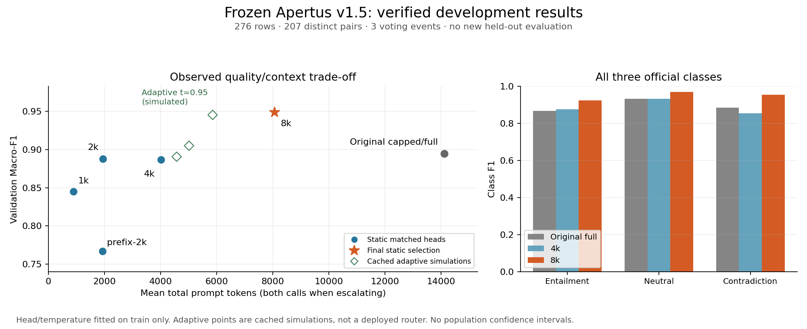
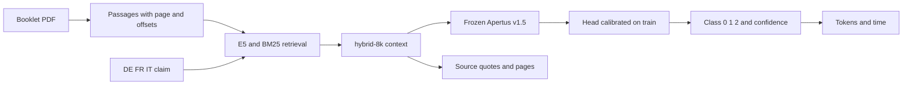

# Phase2: Apertus OST research summary

## 1. Document-dependence controls

| Original system input | Validation Macro-F1 |
|---|---:|
| Correct booklet |0.894461|
| Claim only, head trained exclusively on train |0.699640|
| Booklet from another event, same language; seed42 |0.565341|
| Booklet from another event, same language; seed1337 |0.553328|
| Empty premise, frozen original head |0.210229|
| Generic premise, frozen original head |0.174688|

The drop with wrong booklets supports context dependence. The good result without a document shows class signal in the claims alone; these controls do not demonstrate universal semantic grounding. The original labels measure retention under interventions, not the NLI truth of the new pairs.

Controls for the final head/context: wrong-42=0.468262, wrong-1337=0.453133, empty=0.273247. All registered controls required for selection pass.

## 2. Context and observed frontier

| Matched context/head | Macro-F1 | Mean tokens | Cached measured seconds |
|---|---:|---:|---:|
|hybrid-1k|0.844729|893|0.523|
|hybrid-2k|0.887575|1941|0.777|
|hybrid-4k|0.886942|4017|1.365|
|hybrid-8k|0.949069|8060|2.520|
|prefix-2k|0.766764|1921|0.453|
|Original full, A6000 recheck|0.894461|14106|3.316|

The observed frontier among static F1/token/latency configurations contains 1k, 2k, 8k and prefix2k. 4k was the registered efficiency choice under additional per-class and per-language constraints; it is not presented as a globally non-dominated point. The 8k alternative was registered separately after a material improvement was observed. Architecture selection uses validation and is not blind discovery. Latencies for compact contexts sum encoding, retrieval and head separately; they exclude start-up, PDF extraction and HTTP.

## 3. Evidence

Exact text, page, offsets and PDF SHA were verified. The lexical 5-gram overlap with references for hybrid-8k is a development diagnostic, not the official metric. References are never required in production. **12** real inferences were run with only the 1–2 proposed quotes: decision preservation **75.0%**; **12** contexts were strictly reduced, with preservation **75.0%**. This measures sensitivity, not human proof of sufficiency or attribution.

The qualitative inspection of 9 cases per language/class is in evidence-audit.json. Output quotes remain ordered source context, not certified minimal proofs. Neutral requires caution: not finding evidence in the selected context does not prove absence from the whole booklet. The possible scope ambiguity of ost-v1.1-0732 is preserved without changing labels. Neighbor/diversity expansions use 90 fixed cases and are not adopted on the basis of that small sample.

## 4. Frozen architecture

**hybrid-8k**, hybrid E5/BM25 retrieval, whole passages within the native token budget, frozen Apertus v1.5 and a multiclass logistic head trained/calibrated on train only. No LoRA, QLoRA, 70B, quantization or adaptive router.

Final validation: F1 **0.949069**; cross-language **0.941796**; 207 deduplicated pairs **0.945610**. The CLI on 3 cross-language PDFs and a real frontend upload/prediction request were verified on GPU. The Docker frontend requires the configured native backend; the disposable GPUs were destroyed after the evidence was archived.

## 5. Calibration

ECE (10 bins) **0.028410** · Brier **0.070524** · NLL **0.139329**. Temperature chosen with train OOF; no recalibration on validation.

| Confidence | n | Accuracy | Mean confidence |
|---|---:|---:|---:|
|0.00–0.50|3|0.333|0.490|
|0.50–0.70|15|0.467|0.636|
|0.70–0.85|18|0.889|0.793|
|0.85–0.95|30|1.000|0.916|
|0.95–1.00|210|0.990|0.991|

Complementary semantic diagnostic: presence of the source passage nearest to the E5 reference **78.1%** on Entailment/Contradiction cases. It is an approximation that depends on the same retriever, not human evidence recall or an official evaluation; see semantic-reference-diagnostic.json.

The 4k→8k simulation with threshold 0.95 reaches F1 **0.945312**, **5853** tokens and **1.949s**, escalating **22.8%** of the examples. It is a promising alternative, not a negative result. Fixed 8k offers higher F1, higher presence of passages near the reference and a single head/forward; the router lacks its own end-to-end verification and threshold transfer to independent booklets. It is not adopted in production.

The adaptive thresholds were only simulated from cache, counting both forwards when escalating. No additional complexity is adopted. The probabilities of wrong-document controls are not interpreted as calibration of true NLI labels.

## 6. Compute

Total observed Vast spend: **USD4.9787**. Incremental Phase2 spend: **USD1.5128**. Observed remaining credit: **USD5.0213**. Active instances for this task: **0**, destruction verified through the paginated API. The USD2 reserve and the additional USD4.50 cap were kept. Provider accounting is subject to late charges; budget.json and resource-audit.json contain timestamps, prices, duration and per-stage observations.

## 7. Scientific conclusion

**The hypothesis receives partial support on this development benchmark.** Frozen Apertus representations allow a lightweight head with F1 0.949, and the wrong-booklet controls materially reduce retention. The context drops from roughly 14106 to 8060 tokens without sacrificing validation quality. This justifies the final architecture, not a universal claim of reasoning or generalization.

Remaining caveats: class signal in the claims, only 3 events and 2 connected validation units, duplicates/paraphrases, possible scope ambiguity and uncertified evidence. Evaluation on new independent booklets is required. The 310 consumed examples were never reopened in Phase2: their historical F1 0.899920 belongs only to the original full system, not to the new compact head. This evidence does not justify spending the remaining credit on LoRA.

Full source: [technical_report.md](../../technical_report.md); metrics: context-results.json, final-results.json and accuracy-results.json when present; errors: selected-error-analysis.jsonl.

The 4k and 8k minimal-evidence audits use different class/language-stratified cohorts; 3/12 versus 9/12 is descriptive, not a paired causal comparison.
